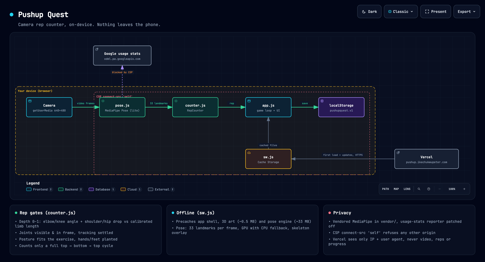

# Pushup Quest

A pushup and squat RPG that runs in the browser. Prop your phone up, and the camera counts your reps: every full rep strikes a monster, and monsters drop XP, gold and loot. A pose model runs on the device, so the video is analyzed where it is captured and never uploaded. Your progress lives in the browser too. There is no account, no server-side storage and no analytics, and after the first visit it works offline.

**Try it: [pushup.ikechukwupeter.com](https://pushup.ikechukwupeter.com)**. On a phone, open it in Safari or Chrome and add it to the home screen. Then stand the phone on the floor 1.5 to 2 m away, side-on, so your shoulders, arms and hips are in view.

```text
Camera → pose landmarks → depth signal → rep gates → rep → damage, XP, loot → saved on the device
```

**[Read the case study](docs/case-study.md)** for the design, the trade-offs, and the bugs. Most of the bugs were found by replaying real exercise footage, not by guessing.

[](docs/architecture.html)

The diagram is interactive and self-contained: open [architecture.html](docs/architecture.html) in a browser to trace paths, search and export. Its source is [docs/diagrams/architecture.json](docs/diagrams/architecture.json), rendered with Archify.

## What it does

- **Counts reps from the camera, on the device.** MediaPipe's Pose Landmarker returns 33 body landmarks per frame. It runs in WebAssembly on the GPU, falling back to the CPU. See [pose.js L8-L23](pose.js#L8-L23).
- **Turns a pose into one number.** Each frame becomes a depth signal from 0 to 1. For pushups that's the larger of two cues: how bent the elbows are, and how far the shoulders have dropped toward the wrists compared with arm length measured when the arms were straight. The second cue is what makes it work from the front, where a bent elbow can look straight. Squats do the same with knees and hips. See [counter.js L172-L193](counter.js#L172-L193).
- **Counts only full reps.** A rep is top, then bottom held for a moment, then back to the top. Half reps don't count. See [counter.js L89-L155](counter.js#L89-L155).
- **Refuses to guess.** A rep counts only when every gate passes:
  - The joints it needs are confidently seen and inside the frame. The model guesses joints that are off-screen, and those guesses are ignored.
  - Tracking has settled.
  - The posture fits the exercise: not upright for pushups, upright for squats.
  - The hands (or feet) stay planted.

  This is what stops squats, walking around and sitting at a desk from counting as pushups. See [counter.js L20-L37](counter.js#L20-L37).
- **Says why it isn't counting.** "Move back so your hips are in view too", "Keep your hands planted". Messages are debounced, so two competing reasons can't flicker. See [app.js L634-L655](app.js#L634-L655).
- **Recovers quickly.** If you lie flat or step out briefly, it keeps your calibration and locks back on within about 0.1 s. Only after 3 s away does it start over. See [counter.js L119-L130](counter.js#L119-L130).
- **Is a game, not a spreadsheet.** 6 zones of 10 stages with a boss each, and harder cycles after the last boss. Damage carries over between sessions. Loot gives bonus XP or gold but never extra reps, so what's counted is always what you did. There's a daily goal, streaks, 18 achievements and 6 heroes with skin tones. See [app.js L196-L230](app.js#L196-L230).
- **Works offline.** The service worker caches the app, the 3D art (about 0.5 MB) and the pose engine (about 33 MB). Updates install in the background and apply on the next open. See [sw.js](sw.js).
- **Works hands-free.** The phone counts reps out loud, calls out the last few reps and kills, and reads setup problems aloud ("Move back so your hips are in view too"). It uses only the phone's on-device voices. A rep that goes partway down plays a "too shallow" sound and says "Go lower".
- **Guides you into position.** Before counting starts, an outline shows where your body should be and a checklist turns green as the camera finds your shoulders, elbows, hands and hips. Counting starts by itself once it can see you; the guide comes back if you leave the frame for 3 s.
- **Rewards form.** Each counted rep reports its depth and tempo. Deep, controlled reps land a *perfect* hit (double damage; still one rep), and the battle report gives a form score.
- **Keeps a streak alive.** Every 7 days of streak earns a freeze (up to 2) that covers a missed day automatically. Daily goals can follow a plan: fixed, build-up (adapts weekly to how often you hit it), or a 6-week challenge to double it.
- **Shares a result card,** drawn on the device and handed to the phone's share sheet, and reminds you monthly to back up, since progress lives only on the phone.
- **Has a tap mode.** With no camera, or if permission is denied, you tap the screen for each rep.

## Run it locally

```sh
npm start                  # http://localhost:8765 (the camera works on localhost, otherwise it needs HTTPS)
npm test                   # 36 tests: synthetic poses, replayed real footage, save integrity. No browser, no camera.
npm run smoke              # headless Chrome: app loads, camera + pose model start, nothing leaves the origin
npm run smoke -- clip.mjpeg   # same, with a video as the camera; asserts the rep count (EXPECT_REPS, default 6)
npm run extract -- <video> <out.json> --title T --author A --license L --url U
                           # turn any exercise video into a test fixture (needs ffmpeg + Chrome)
```

There is nothing to install. The app has no dependencies and no build step, and the tooling uses only Node 22's standard library.

**Warnings:**
- **The service worker serves files from its cache first.** After changing any app file, bump `VERSION` in [sw.js](sw.js#L2), or the old copy keeps being served. Bump `VENDOR` only when `vendor/` changes.
- **The counter is tuned for a side view.** It works from the front but misses more reps there. See [Status](#status).
- **Opening it on a phone over the LAN won't work.** Browsers allow the camera only on `localhost` or HTTPS.

## How it fits together

```text
index.html            shell, Content-Security-Policy, tab bar
app.js                game state, views, battle screen, save/load, settings (classic script)
pose.js               camera + MediaPipe Pose Landmarker + skeleton overlay (ES module, lazy-loaded)
counter.js            RepCounter: landmarks → depth signal → gates → reps (pure, no DOM, tested)
integrity.js          save signing, rebuild and plausibility checks (pure, no DOM, tested)
sw.js                 offline cache: app shell + art + pose engine
styles.css            the whole UI
art/                  3D art (Fluent Emoji 3D, MIT), WebP
vendor/               MediaPipe tasks-vision 1.1.1 + pose model, vendored, telemetry patched off

tests/counter.test.js  synthetic poses with known geometry
tests/footage.test.js  real exercise footage, replayed + stress cases built from it
tests/integrity.test.js  honest saves pass, edited saves are caught
tests/fixtures/        landmarks extracted from public videos, with licences
scripts/serve.mjs      local static server
scripts/extract-landmarks.*   video → fixture, using the app's own pose model

docs/case-study.md            the design, the trade-offs, the bugs
docs/accuracy.md              what was measured, and how to rerun it
docs/decisions/               why the non-obvious choices were made
docs/architecture.html        interactive architecture diagram
```

## What leaves the device, and when

| Component | What it sees | What it sends anywhere |
|---|---|---|
| Camera + `pose.js` | Every video frame during a battle | Nothing. Frames go to the on-device model and are dropped; the camera stops when you leave the battle. |
| `counter.js`, `app.js` | Landmarks, reps, your progress | Nothing. Progress is written to `localStorage` on this device. |
| `sw.js` | Requests for the app's own files | Fetches app files from the host on the first visit and for updates. Nothing else. |
| MediaPipe (`vendor/`) | Frames, and its own speed stats | Nothing. Upstream posts usage statistics to `odml.pa.googleapis.com` every 60 s. That is patched off in [vendor/vision_bundle.mjs](vendor/vision_bundle.mjs), and the CSP would block it anyway. |
| Feedback links (Settings) | Nothing | Nothing from the app. They open a pre-filled email draft or GitHub issue; only what the person chooses to send is shared. |
| The host (Vercel) | Ordinary request details (IP, user agent) when files are downloaded | Not applicable. It never receives video, reps or progress. |

The [Content-Security-Policy](index.html#L12) (`connect-src 'self'`), also sent as a header by [vercel.json](vercel.json), makes the browser refuse any connection to another origin. To check it, I recorded every request during a 75-second camera battle. With the unpatched library, the browser blocked its usage report at about 60 s. With the patch, nothing tried to leave at all. The same promise is shown to users on first launch and under Settings → Privacy.

## Things worth knowing

**A returned landmark is not a seen landmark.** The model always returns 33 points, including ones it guessed off-screen, sometimes with middling confidence. Trusting them produced reps from someone sitting at a desk with their hands below the frame. So a joint must be both confident and inside the frame ([counter.js L37](counter.js#L37)).

**From the front, the elbow angle lies.** A camera flattens the scene to 2D. A straight arm always looks straight, but a bent one can too, when it bends toward the camera. That's why the depth signal also measures shoulder drop against a calibrated arm length, and takes whichever cue is stronger.

**Missing a rep is cheap; inventing one is not.** Every gate was added because real footage produced a false rep. The cost is honest: front views with a moving camera miss some reps. For a counter people use to keep score against themselves, that trade is right.

**Hands stay planted in a pushup, and that's the best test there is.** In a squat your whole body, hands included, drops. In a real pushup the hands don't move. Each hand is tracked separately, because the far hand often vanishes behind the body at the bottom, and a two-hand average would jump when it does.

**Headless Chrome does not repaint a seeked `<video>`.** The first batch of "measurements" was the first frame repeated hundreds of times. Fixtures are now made from JPEG frames fed as images ([scripts/extract-landmarks.html](scripts/extract-landmarks.html)).

**A save on the player's phone can always be edited, so the app makes edits evident instead.** Every save is signed, totals are rebuilt from history, and gold, XP and progress are checked against the most that could have been earned. An edited save still plays, with a badge; a future leaderboard won't trust a phone's totals at all. See [decision 008](docs/decisions/008-tamper-evident-saves.md).

**"Nothing leaves your phone" took code, not just copy.** The privacy notice was written last, after the network log showed it would be true.

## Deploy it

It's a static site, so any HTTPS host works. On Vercel:

```sh
vercel deploy --prod
```

[vercel.json](vercel.json) sets no build step, a CSP and `Permissions-Policy` header, and `no-cache` on `sw.js`. [.vercelignore](.vercelignore) keeps tests, tooling and docs out of the upload.

**Custom domain:** add it under the project's Domains in Vercel (here `pushup.ikechukwupeter.com`), then create the CNAME record it shows at your DNS provider.

**Warnings:**
- **HTTPS is required** for the camera and for installing to the home screen.
- **Bump `VERSION` in sw.js on every deploy** that changes app files, or installed copies keep the old ones.

## Status

**Working:**
- camera counting for pushups and squats, front or back camera
- tap mode
- the full game loop
- offline install
- save export/import
- privacy lock
- 36 tests passing, plus a browser smoke test on every push (GitHub Actions)

**Measured:** against real footage, replayed in [tests/footage.test.js](tests/footage.test.js). The results are in [docs/accuracy.md](docs/accuracy.md).
- **Real reps:** 6 of 6 side-view pushups, 2 of 2 squats.
- **False reps:** zero across close-ups, talking, burpees, squats in pushup mode, walking out of frame, and 40 s idle at a desk.
- **Lying flat mid-set:** no reps lost.
- **Live:** the full app, run in Chrome against the same pushup video, counted 6 of 6.

**Not built:**
- **Server-backed features:** syncing between devices, friends, guilds, leaderboards and reminders all need a server. That is a deliberate trade against "nothing leaves the device".
- **Other exercises:** none beyond pushups and squats.
- **Device testing:** no measurements on a range of phones yet.
- **Front views:** accuracy is weaker from the front.

## Credits

Directed and verified by me: the product, the requirements, the accuracy bar, testing on my own body and webcam, and the failures that drove each fix (counting out of frame, squats counted as pushups, slow recovery after lying down). The code, test harness and docs were written with AI assistance (Claude), then checked against real footage, a live camera and a network log before anything was called done.

- Pose detection: [MediaPipe](https://github.com/google-ai-edge/mediapipe) by Google (Apache-2.0).
- 3D art: [Fluent Emoji](https://github.com/microsoft/fluentui-emoji) by Microsoft (MIT).
- Test footage authors are credited in [tests/fixtures/README.md](tests/fixtures/README.md).

## License

MIT, for the code in this repo. Use it freely for learning, interviews, or as a starting point for your own fitness game. If it helped you, I'd love to hear about it. Bundled third-party files keep their own licences: see [THIRD_PARTY_NOTICES.md](THIRD_PARTY_NOTICES.md).
